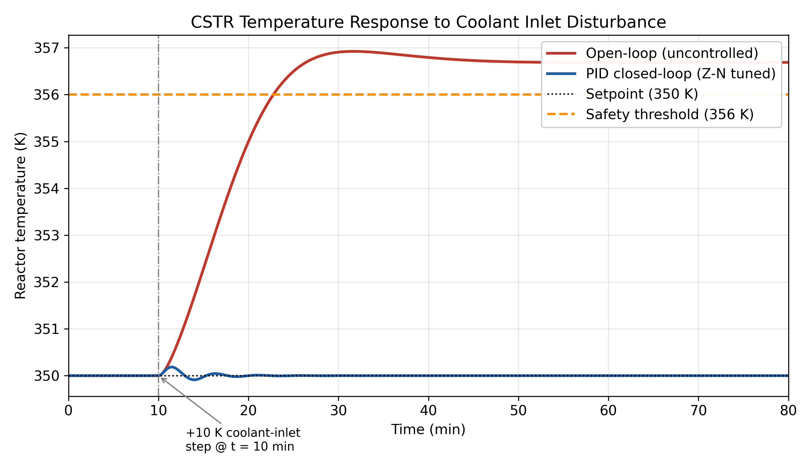
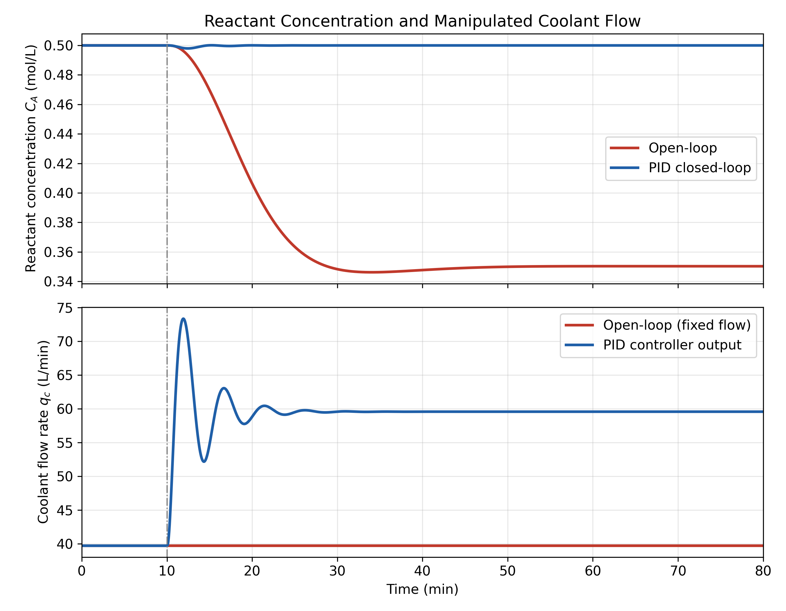

# CSTR Temperature Control: PID Loop with Ziegler-Nichols Tuning

Dynamic simulation of a non-isothermal, jacketed Continuous Stirred Tank Reactor (CSTR) running an exothermic reaction, with a discrete PID controller that manipulates coolant flow to reject a coolant-inlet temperature disturbance.

## Project Overview and Industrial Relevance

Exothermic reactions such as nitration, polymerisation, esterification and hydrogenation release heat in proportion to an Arrhenius rate term. If heat removal falls behind heat generation, temperature rises, the rate rises, and more heat is released. This feedback is the mechanism behind **thermal runaway**, a leading cause of serious incidents in chemical manufacturing.

A common upset is a rise in cooling-water supply temperature (hot weather, cooling-tower fouling, upstream load). This project quantifies what that upset does to a reactor and how much a properly tuned PID loop limits it:

- **Plant:** first-order, irreversible A -> B in a jacketed CSTR (reactor, jacket and temperature sensor dynamics all modelled).
- **Disturbance:** +10 K step in coolant inlet temperature at t = 10 min.
- **Controller:** discrete PID on measured reactor temperature, manipulating coolant flow, with a derivative filter, valve limits and anti-windup.
- **Tuning:** Ziegler-Nichols ultimate-gain rules, with Ku and Pu computed analytically from the linearised plant.

## Governing Equations

Let $C_A$ be reactant concentration, $T$ reactor temperature, $T_j$ jacket temperature and $T_m$ the sensor reading.

**Mass balance on A**

$$\frac{dC_A}{dt} = \frac{q}{V}\left(C_{Af} - C_A\right) - k(T)\,C_A$$

**Reactor energy balance**

$$\frac{dT}{dt} = \frac{q}{V}\left(T_f - T\right) + \frac{(-\Delta H_r)\,k(T)\,C_A}{\rho\, C_p} - \frac{UA}{V\rho\, C_p}\left(T - T_j\right)$$

**Jacket energy balance**

$$\frac{dT_j}{dt} = \frac{q_c}{V_j}\left(T_{c,in} - T_j\right) + \frac{UA}{V_j\,\rho_c C_{p,c}}\left(T - T_j\right)$$

**Temperature sensor (first-order lag)**

$$\frac{dT_m}{dt} = \frac{T - T_m}{\tau_s}$$

**Arrhenius kinetics**

$$k(T) = k_0 \exp\!\left(-\frac{E}{R\,T}\right)$$

**Discrete PID (reverse-acting, with $e_k = T_{m,k} - T_{sp}$)**

$$q_{c,k} = q_{c,nom} + K_p\left[e_k + \frac{1}{\tau_i}\sum_{j \le k} e_j \Delta t + \tau_d \frac{\Delta e_k}{\Delta t}\right]$$

The derivative term is low-pass filtered, and the integrator is frozen while the valve is saturated (conditional-integration anti-windup).

## Reactor Parameters

| Parameter | Symbol | Value | Unit |
|---|---|---|---|
| Reactor volume | $V$ | 500 | L |
| Feed flow rate | $q$ | 50 | L/min |
| Feed concentration | $C_{Af}$ | 2.0 | mol/L |
| Feed temperature | $T_f$ | 320 | K |
| Fluid density | $\rho$ | 1000 | g/L |
| Fluid heat capacity | $C_p$ | 4.18 | J/(g K) |
| Activation energy | $E$ | 70,000 | J/mol |
| Pre-exponential factor (derived) | $k_0$ | $8.40 \times 10^{9}$ | 1/min |
| Heat of reaction | $\Delta H_r$ | -150,000 | J/mol |
| Jacket volume | $V_j$ | 50 | L |
| Heat-transfer coefficient x area (derived) | $UA$ | 166,000 | J/(min K) |
| Coolant inlet temperature | $T_{c,in}$ | 290 | K |
| Nominal coolant flow (derived) | $q_{c,nom}$ | 39.71 | L/min |
| Sensor time constant | $\tau_s$ | 0.2 | min |
| Controller sample time | $\Delta t$ | 0.05 | min |
| Valve range | $q_c$ | 0 to 2 x nominal | L/min |

$k_0$, $UA$ and $q_{c,nom}$ are back-calculated so the plant sits exactly at the design point: $T = 350$ K, $C_A = 0.50$ mol/L (75 % conversion), $T_j = 320$ K. The nominal steady state is open-loop stable (dominant eigenvalue about -0.088 1/min), so the study isolates the effect of the disturbance rather than an unstable operating point.

## Ziegler-Nichols PID Tuning

The ultimate gain $K_u$ and ultimate period $P_u$ come from the frequency response of the linearised plant (phase crossover at -180 degrees), then the classical rules apply: $K_p = 0.6K_u$, $\tau_i = P_u/2$, $\tau_d = P_u/8$.

| Quantity | Value |
|---|---|
| Ultimate gain $K_u$ | 183.1 L/min per K |
| Ultimate period $P_u$ | 2.44 min |
| **$K_p$** | **109.9 L/min per K** |
| **$\tau_i$** | **1.22 min** |
| **$\tau_d$** | **0.305 min** |

## Results





### Results Summary (+10 K coolant-inlet step at t = 10 min)

| Metric | Open-Loop | PID Closed-Loop (Z-N) |
|---|---|---|
| Peak temperature | 356.92 K | 350.18 K |
| Peak overshoot above setpoint | 6.92 K (1.98 % of setpoint) | 0.18 K (0.05 % of setpoint) |
| Settling time (within +/- 0.1 K of final value) | 30.3 min | 2.35 min |
| Steady-state error | +6.69 K | 0.00 K |
| Exceeds 356 K safety threshold | Yes | No |

**Peak overshoot is reduced by about 97 %** relative to open-loop. In open loop the reactor settles at a new, hotter steady state about 6.7 K above setpoint, crossing the safety threshold, and conversion drifts from 75 % to about 82.5 % ($C_A$ falls from 0.50 to about 0.35 mol/L), which means off-spec product. Under PID control the coolant flow rises from 39.7 to about 59.6 L/min, which restores the setpoint with zero offset.

Definitions: overshoot is the maximum of $T$ above setpoint after the disturbance, shown in K and as a percentage of the setpoint (Kelvin basis). Settling time is measured from the disturbance until $T$ stays within a 0.1 K band of its final value. Steady-state error is $T(t_{end}) - T_{sp}$.

## Installation and Usage

1. Clone the repository and enter it:
   ```bash
   git clone https://github.com/<your-username>/cstr-pid-control.git
   cd cstr-pid-control
   ```
2. (Recommended) Create a virtual environment:
   ```bash
   python -m venv venv
   source venv/bin/activate        # Windows: venv\Scripts\activate
   ```
3. Install dependencies:
   ```bash
   pip install -r requirements.txt
   ```
4. Run the simulation:
   ```bash
   python cstr_simulation.py
   ```
5. The terminal prints the tuning parameters and performance metrics, and two 300 DPI figures are saved in the project folder: `cstr_temperature_response.png` and `cstr_concentration_control.png`.

## Repository Structure

```
cstr-pid-control/
|-- cstr_simulation.py              # model, tuning, simulation, metrics, plots
|-- requirements.txt
|-- README.md
|-- cstr_temperature_response.png   # generated
|-- cstr_concentration_control.png  # generated
```

## Limitations and Possible Extensions

- Single reaction, constant physical properties, perfectly mixed reactor and jacket.
- Ziegler-Nichols tuning is intentionally aggressive; comparing it with IMC or Cohen-Coon tuning is a natural next step.
- Measurement noise, actuator dynamics and transport delay are not modelled. Adding them would make the Z-N result more conservative.
- Extensions: cascade control (jacket temperature inner loop), feed-forward from coolant inlet temperature, and an unstable operating point to study runaway directly.

## License

MIT
